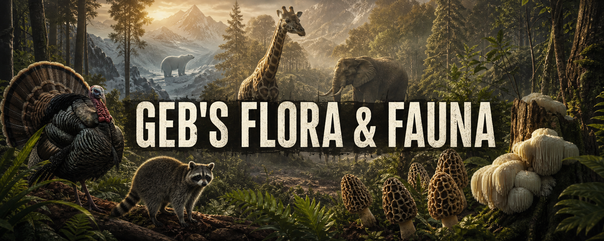

# Geb's Flora & Fauna

Geb's Flora & Fauna expands DayZ's ecosystem with new wildlife, harvestable resources, fungi, and survival crafting. The animals are designed as server-configured Central Economy encounters rather than effortless sources of food: server owners decide which species appear, where they live, and how common they are.

## Included content

- Wildlife: chimpanzee, alien, penguin, rabbit, camel, elephant, giraffe, male and female turkey, peacock, black bear, polar bear, raccoon, and cheetah.
- Mycology: black morel, white morel, lion's mane, and puffball mushrooms.
- Harvesting: species-specific meat, pelts, raccoon tail, and elephant tusk where supported.
- Crafting: prepare a turkey with supported cutting tools and craft a raccoon-skin cap from a raccoon pelt and tail.
- Localization: a DayZ `stringtable.csv` for supported interface languages.

## Installation

1. Subscribe to [Workshop item 2764114664](https://steamcommunity.com/sharedfiles/filedetails/?id=2764114664).
2. Install the published `@gebsflorafauna` folder beside the DayZ server executable.
3. Copy the included `.bikey` into the server's `keys` folder.
4. Add `-mod=@gebsflorafauna` to the server launch parameters. Every connecting player must load the same Workshop mod.
5. Add the desired classnames to the mission's Central Economy files. The mod does not replace your server's animal balance automatically.

The [server-owner guide](https://packjc.github.io/gebsflorafauna/#install) explains `events.xml`, `cfgeventspawns.xml`, validation, and testing in detail.

## Main classnames

| Category | Classnames |
| --- | --- |
| Animals | `geb_Chimp`, `geb_Alien`, `geb_Penguin`, `geb_Rabbit`, `geb_Camel`, `geb_Elephant`, `geb_Giraffe`, `geb_Female_Turkey`, `geb_Turkey`, `geb_Peacock`, `geb_Blackbear`, `geb_Polarbear`, `geb_Racoon`, `geb_Cheetah` |
| Mushrooms | `geb_BlackMorel`, `geb_WhiteMorel`, `geb_LionsMane`, `geb_PuffBall` |
| Crafting | `geb_RacoonSkinCap` |

The complete searchable list of 39 public config classes is available on the [project website](https://packjc.github.io/gebsflorafauna/#classnames).

## Usage and distribution

The Steam Workshop item is the authorized distribution source. Do not re-upload, repack, mirror, or include the mod in a server/mod pack. Use a Steam Collection to publish a server's required mod list. Refer to the Workshop page for the complete current terms.

## Support

- [Discord](https://discord.gg/G8uSGZ8yyf)
- [GitHub issues](https://github.com/PackJC/gebsflorafauna/issues)
- [Steam Workshop](https://steamcommunity.com/sharedfiles/filedetails/?id=2764114664)

Copyright 2022–2026 Cole / PackJC.
