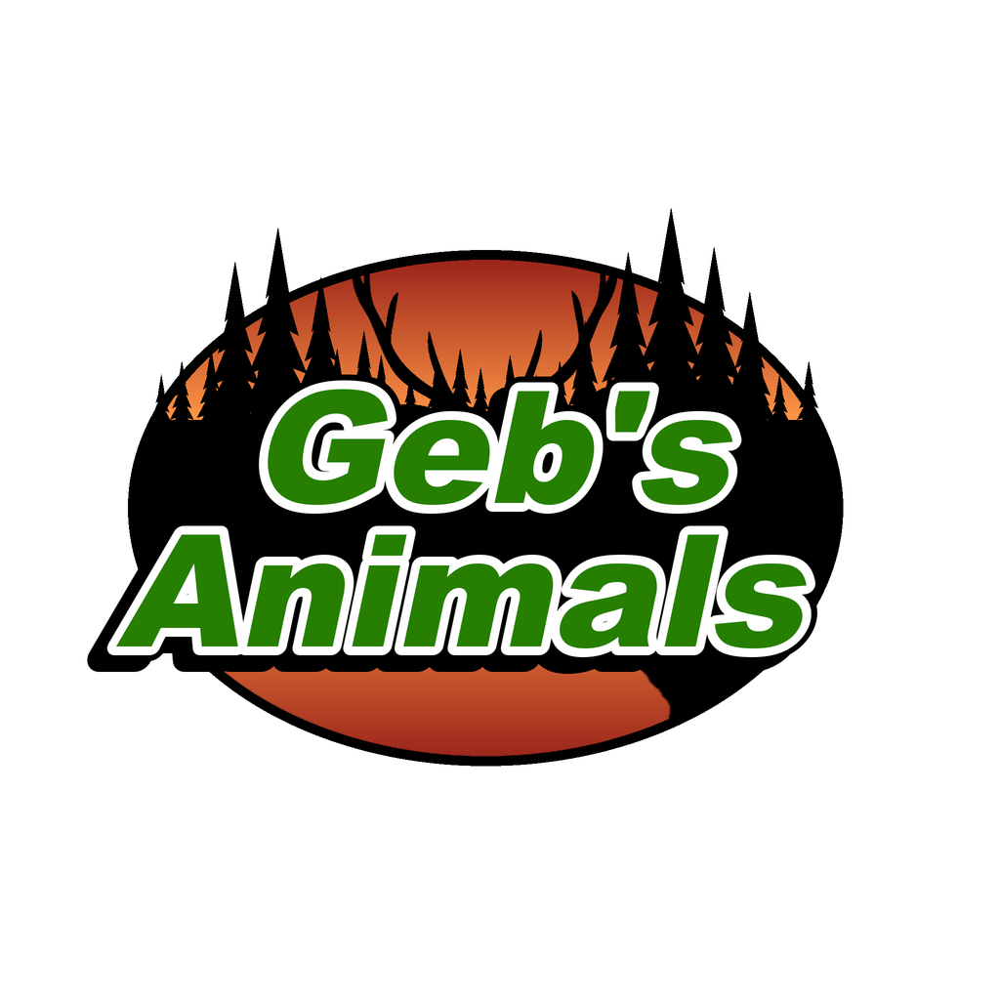

<h1 align="center">
   
  
   
  
   
</h1>

<h3 align="center">New Wildlife for DayZ</h3>

  
  
  
  

  <a href="https://packjc.github.io/gebsanimals/">Website</a> •
  <a href="#key-features">Key Features</a> •
  <a href="#installation">Installation</a> •
  <a href="#main-classnames">Classnames</a> •
  <a href="#credits">Credits</a> •
  <a href="#license">License & Terms</a> •
  <a href='CHANGELOG.md'>Change Log</a>

## Information

Geb's Animals adds 15 new animals to DayZ, each with its own model, sounds and harvest.
The animals are server-configured Central Economy encounters rather than free food: server owners decide which species appear, where they live, and how common they are.

## Requirements

* DayZ 1.30. No other mods are needed: load Geb's Animals on both the server and every client.

## Key Features

* **15 wildlife species**: chimpanzee, alien, penguin, rabbit, camel, elephant, giraffe, male and female turkey, peacock, black bear, polar bear, panda bear, raccoon and cheetah.
* **Harvesting**: species-specific meat, pelts, a raccoon tail and elephant tusks.
* **Crafting**: prepare a turkey with a blade, and craft a coonskin cap from a raccoon pelt and tail.
* **Server-controlled by design**: nothing replaces vanilla wildlife. You add only the event definitions and spawn positions you want.
* Supported languages:
  - English
  - Czech
  - German
  - Russian
  - Polish
  - Hungarian
  - Italian
  - Spanish
  - French
  - Chinese (Traditional and Simplified)
  - Japanese
  - Portuguese
  > **Note**
  > Although supported languages are listed above, we cannot verify complete accuracy. If you are a native speaker and notice anything wrong, please reach out to us in the Discord via a ticket to assist us in getting proper translations.

## Installation

1. Subscribe to Geb's Animals on the [Steam Workshop](https://steamcommunity.com/sharedfiles/filedetails/?id=2764114664).
2. Install the published `@gebsanimals` folder beside the DayZ server executable.
3. Copy the included `.bikey` into the server's `keys` folder.
4. Add `-mod=@gebsanimals` to the server launch parameters. Every connecting player must load the same Workshop mod.
5. Add an event for each species you want in the mission's `db/events.xml`, with spawn positions in `cfgeventspawns.xml`. The mod doesn't change your server's animal balance by itself.

The [server-owner guide](https://packjc.github.io/gebsanimals/#setup) walks through every step, with copy-ready XML.

## Main Classnames

| Category | Classnames |
| --- | --- |
| Animals | `geb_Blackbear`, `geb_Camel`, `geb_Cheetah`, `geb_Chimp`, `geb_Elephant`, `geb_Female_Turkey`, `geb_Giraffe`, `geb_Alien`, `geb_Pandabear`, `geb_Peacock`, `geb_Penguin`, `geb_Polarbear`, `geb_Rabbit`, `geb_Racoon`, `geb_Turkey` |
| Meat | `geb_CamelMeat`, `geb_CheetahMeat`, `geb_ChimpMeat`, `geb_ElephantMeat`, `geb_GiraffeMeat`, `geb_AlienMeat`, `geb_PeacockMeat`, `geb_PenguinMeat`, `geb_RabbitMeat`, `geb_RacoonMeat`, `geb_TurkeyMeat` |
| Pelts | `geb_BlackbearPelt`, `geb_CheetahPelt`, `geb_ElephantPelt`, `geb_GiraffePelt`, `geb_AlienSkin`, `geb_PandabearPelt`, `geb_PolarbearPelt`, `geb_RacoonPelt` |
| Resources | `geb_ElephantTusk`, `geb_RacoonTail` |
| Crafting | `geb_RacoonSkinCap` |

The complete searchable list of 37 public config classes is on the [project website](https://packjc.github.io/gebsanimals/#classnames).

## The Geb's family

Every mod by Geb stands on its own, so a server can run the ones it wants:

* [Gebsfish](https://github.com/PackJC/gebsfish) ([wiki](https://packjc.github.io/gebsfish/)): the fishing overhaul: 94 catchable species, rods, lures, coolers, the jon boat and more
* [Geb's Animals](https://github.com/PackJC/gebsanimals) ([website](https://packjc.github.io/gebsanimals/)) (this mod): 15 wildlife species
* [Geb's Plants](https://github.com/PackJC/gebsplants) ([website](https://packjc.github.io/gebsplants/)): 27 garden crops and wild ginseng
* [Geb's Mushrooms](https://github.com/PackJC/gebsmushrooms) ([website](https://packjc.github.io/gebsmushrooms/)): 63 edible and poisonous fungi
* [Alien Invasion](https://github.com/PackJC/alieninvasion) ([website](https://packjc.github.io/alieninvasion/)): UFO crash sites, Little Green Men and the Montauk plasma rifle
* [Great Smoky Mountains](https://github.com/PackJC/greatsmokymountains) ([Workshop](https://steamcommunity.com/sharedfiles/filedetails/?id=2812533524)): a 20 x 20 km map of the Smokies at real scale

Geb's Animals, Plants and Mushrooms used to be one mod, **Geb's Flora & Fauna**. The classnames are unchanged: a server that ran it should load all three to keep every item players already have, because leaving one out deletes its items from the server's storage at the next restart.

## Credits

- [CADNav](https://www.cadnav.com/) for the camel, elephant, chimpanzee, cheetah, peacock, rabbit and giraffe models
- [Emperor Penguin model](https://sketchfab.com/3d-models/emperor-penguin-310f1d21cf534fd0bcf073aa9b08a740), [Brown Raccoon model](https://www.turbosquid.com/3d-models/3d-fully-rigged-brown-raccoon-model-1710706), [Realistic Alien model](https://www.cgtrader.com/3d-models/character/sci-fi-character/realistic-alien-8) and [Rigged Turkey model](https://www.turbosquid.com/3d-models/turkey-rigged-3d-model-1602065)
- Alien sounds by Geb; animal sounds from [JarredGibb (Freesound)](https://freesound.org/people/JarredGibb/sounds/233125/), SoundBible's [chimpanzee](https://soundbible.com/1188-Chimpanzee.html) (Attribution 3.0), [elephant](https://soundbible.com/1140-Elephant.html), [raccoon](https://soundbible.com/1853-Raccoon.html), [mountain lion](https://soundbible.com/1160-Mountain-Lion.html) and [peacock](https://soundbible.com/1430-Peacock.html), and the [penguin](https://www.freesoundslibrary.com/penguin-noise/) from Free Sounds Library
- The DayZ community for reporting bugs and inspiration throughout the life of the mod

## Support

If you like this project and think it has improved your server in any way, consider contributing! We are always looking for help with ideas, new models, and any monetary support that can help improve the mod. Open a ticket in the [Discord](https://discord.gg/G8uSGZ8yyf) to discuss how you can contribute, or report a bug on [GitHub](https://github.com/PackJC/gebsanimals/issues).

## License

[Attribution-NonCommercial-NoDerivatives 4.0 International](https://github.com/PackJC/gebsanimals/blob/master/LICENSE)

## Usage & Terms
This item is NOT authorized (strictly forbidden) for any of these conditions:
- posting on Steam, except under the Steam account Cole.
- hosting on any download server other than Geb's Animals current workshop download.
- hosting on any launcher for distribution other than Geb's Animals current workshop download.
- to be packaged in any form other than Geb's Animals current workshop download.
- to create derivative works.

## PERMISSION IS NOT GRANTED FOR THIS MOD TO BE INCLUDED IN A "SERVER PACK" or "MOD PACK" DO NOT EVEN ASK TO REPACK. NO. NOT ALLOWED.
Use a Collection if you want to include this mod on your server for your users.

## Monetization
You are hereby given monetization approval under the conditions that you follow the DayZ Server Monetization agreement and have obtained permission from Bohemia. Read more here https://www.bohemia.net/monetization

## Donations
We accept donations at https://www.paypal.com/paypalme/packjc every dollar counts and we greatly appreciate any contributions!

### Copyright © Smoky Mountain Software 2022-2026
