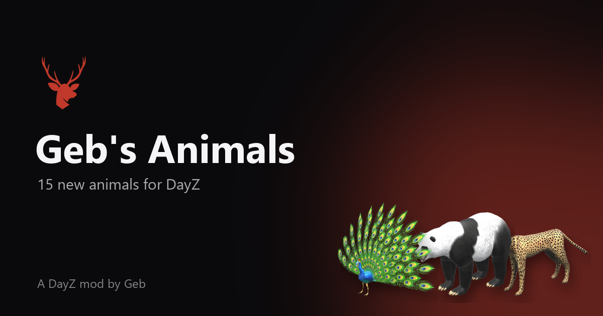

<h1 align="center">
   
  
   
  
  
   
</h1>

<h3 align="center">New Wildlife for DayZ</h3>

  
  

  <a href="https://packjc.github.io/gebsanimals/">Website</a> •
  <a href="#information">Information</a> •
  <a href="#key-features">Key Features</a> •
  <a href="#installation">Installation</a> •
  <a href="#main-classnames">Classnames</a> •
  <a href="#support">Support</a> •
  <a href="#license--terms">License & Terms</a>

## Information

Geb's Animals adds 15 new animals to DayZ, each with its own model, sounds and harvest. The animals are server-configured Central Economy encounters rather than effortless food: server owners decide which species appear, where they live, and how common they are.

## Key Features

* **15 wildlife species**: chimpanzee, alien, penguin, rabbit, camel, elephant, giraffe, male and female turkey, peacock, black bear, polar bear, panda bear, raccoon and cheetah.
* **Harvesting**: species-specific meat, pelts, a raccoon tail and elephant tusks.
* **Crafting**: prepare a turkey with a blade, and craft a coonskin cap from a raccoon pelt and tail.
* **Server-controlled by design**: nothing replaces vanilla wildlife. You add only the event definitions and spawn positions you want.
* **Localization**: a DayZ `stringtable.csv` for the supported interface languages.

## Installation

1. Subscribe to Geb's Animals on the [Steam Workshop](https://steamcommunity.com/sharedfiles/filedetails/?id=2764114664).
2. Install the published `@gebsanimals` folder beside the DayZ server executable.
3. Copy the included `.bikey` into the server's `keys` folder.
4. Add `-mod=@gebsanimals` to the server launch parameters. Every connecting player must load the same Workshop mod.
5. Add an event for each species you want in the mission's `db/events.xml`, with spawn positions in `cfgeventspawns.xml`. The mod doesn't change your server's animal balance by itself.

The [server-owner guide](https://packjc.github.io/gebsanimals/#setup) walks through every step, with copy-ready XML.

## Main Classnames

| Category | Classnames |
| --- | --- |
| Animals | `geb_Blackbear`, `geb_Camel`, `geb_Cheetah`, `geb_Chimp`, `geb_Elephant`, `geb_Female_Turkey`, `geb_Giraffe`, `geb_Alien`, `geb_Pandabear`, `geb_Peacock`, `geb_Penguin`, `geb_Polarbear`, `geb_Rabbit`, `geb_Racoon`, `geb_Turkey` |
| Meat | `geb_CamelMeat`, `geb_CheetahMeat`, `geb_ChimpMeat`, `geb_ElephantMeat`, `geb_GiraffeMeat`, `geb_AlienMeat`, `geb_PeacockMeat`, `geb_PenguinMeat`, `geb_RabbitMeat`, `geb_RacoonMeat`, `geb_TurkeyMeat` |
| Pelts | `geb_BlackbearPelt`, `geb_CheetahPelt`, `geb_ElephantPelt`, `geb_GiraffePelt`, `geb_AlienSkin`, `geb_PandabearPelt`, `geb_PolarbearPelt`, `geb_RacoonPelt` |
| Resources | `geb_ElephantTusk`, `geb_RacoonTail` |
| Crafting | `geb_RacoonSkinCap` |

The complete searchable list of 37 public config classes is on the [project website](https://packjc.github.io/gebsanimals/#classnames).

## The Geb's family

This mod is one of three that used to be **Geb's Flora & Fauna**. Each now stands alone, so a server can run the ones it wants:

* [Geb's Animals](https://github.com/PackJC/gebsanimals) ([website](https://packjc.github.io/gebsanimals/)): 15 wildlife species
* [Geb's Plants](https://github.com/PackJC/gebsplants) ([website](https://packjc.github.io/gebsplants/)): 27 garden crops and wild ginseng
* [Geb's Mushrooms](https://github.com/PackJC/gebsmushrooms) ([website](https://packjc.github.io/gebsmushrooms/)): 63 edible and poisonous fungi

The classnames are unchanged. A server that ran Geb's Flora & Fauna should load all three to keep every item players already have; leaving one out deletes its items from the server's storage at the next restart.

## Support

* [Discord](https://discord.gg/G8uSGZ8yyf)
* [GitHub issues](https://github.com/PackJC/gebsanimals/issues)
* [Steam Workshop](https://steamcommunity.com/sharedfiles/filedetails/?id=2764114664)

## License & Terms

The Steam Workshop item is the authorized distribution source. Do not re-upload, repack, mirror, or include the mod in a server/mod pack. Use a Steam Collection to publish a server's required mod list. Refer to the Workshop page for the complete current terms.

Copyright 2022–2026 Cole / PackJC.
